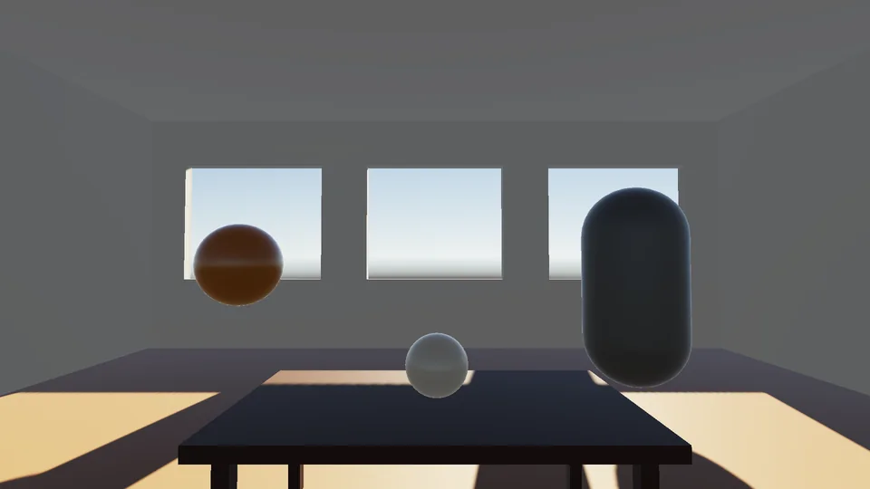
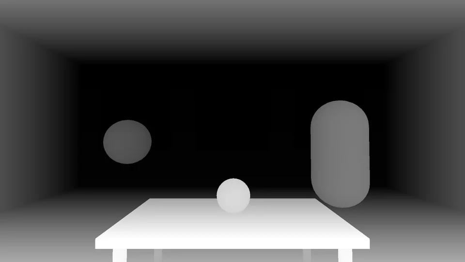
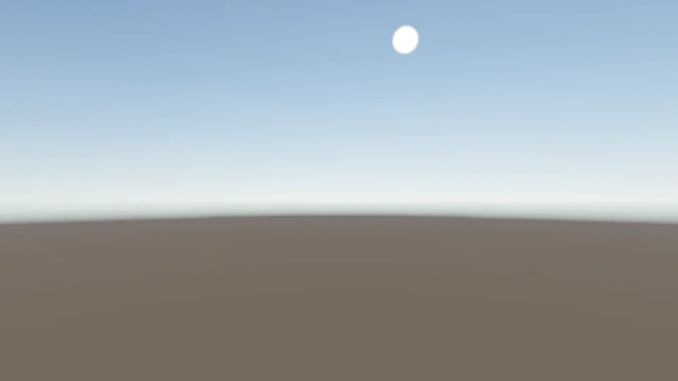
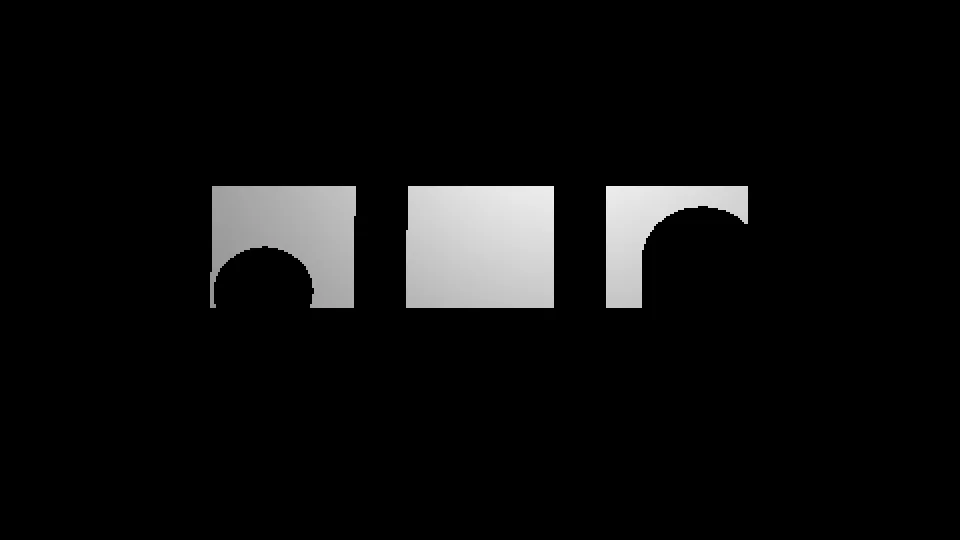
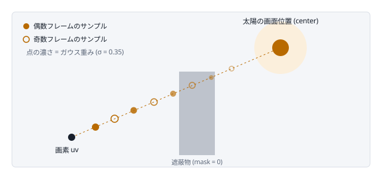
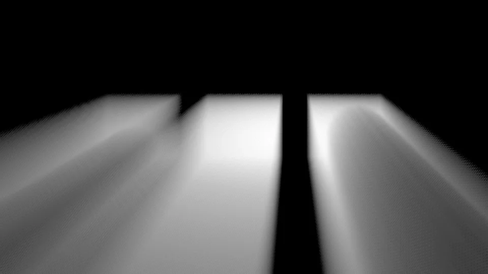
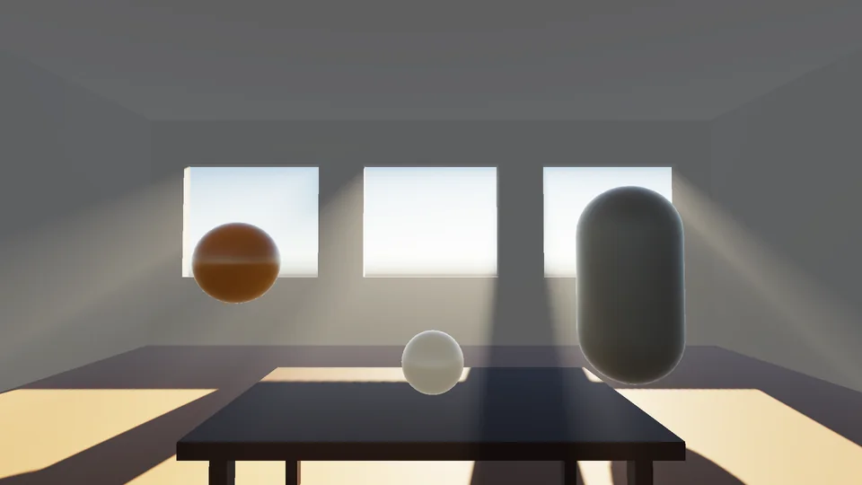
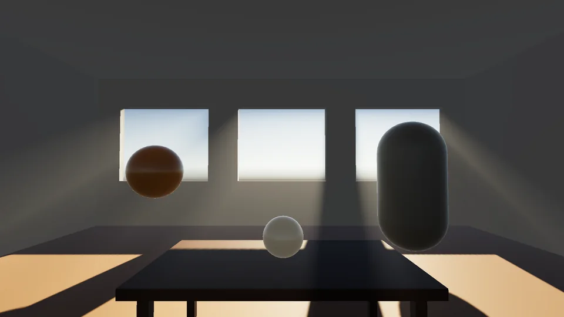

# God Ray（光芒）

空のうち明るい部分だけを取り出し、それを太陽の画面位置に向かって放射状にぼかすと、建物や木の隙間から漏れる光の筋になります。GPU Gems 3 で紹介された「ポストプロセスとしてのボリュメトリック光散乱」と同じ考え方です。このリポジトリでは 1/4 解像度で計算し、サンプルを 2 フレームに分けて時間方向に合成することで負荷を抑えています。

| 項目 | 内容 |
|---|---|
| パス | `GodRayRenderPass.cs` / `GodRayHelper.cs` |
| シェーダー | `GodRay/Binarization`, `GodRay/GodRayRadialBlur` |
| 作業解像度 | カメラの 1/4（幅・高さそれぞれ） |
| Volume | `Sirius/GodRay` |

コード：
- [GodRayRenderPass.cs](../SiriusPackages/Sirius.PostProcessing/Runtime/Scripts/Features/Passes/GodRay/GodRayRenderPass.cs)
- [Binarization.shader](../SiriusPackages/Sirius.PostProcessing/Runtime/Shaders/GodRay/Binarization.shader)
- [GodRayRadialBlur.shader](../SiriusPackages/Sirius.PostProcessing/Runtime/Shaders/GodRay/GodRayRadialBlur.shader)

> **キャプチャ GodRay.rdc**：3 つの窓がある部屋を、窓の外の太陽に向かって見ているシーンです。合成モードは Multiply で、合成結果は別テクスチャ `GodRayResultTex` に書かれています。作業解像度は 480×270 です。

## アルゴリズムの流れ

### 1. 太陽の画面位置を求め、見えないならスキップする

メインライトの向きの逆ベクトル（太陽方向）をビュー空間へ変換し、`w = 0` の方向ベクトルとして射影して透視除算します。`clip.w ≤ 0` なら太陽はカメラの背後なので描画しません。太陽が画面外にあるときは、画面端からの距離に応じて `visibility` を 1 から 0 へ下げ（UV 距離 0.5 で 0）、光芒が急に消えないようにしています。

| 入力：God Ray 適用前のシーンカラー | 入力：カメラ深度 |
|---|---|
|  |  |
| EID 1474 · `_CameraTargetAttachment` · 1920×1080 R11G11B10 | 窓の外（空）は深度 0 で黒くなります。EID 1474 · `_CameraDepthTexture` · 1920×1080 R32F |

### 2. スカイボックスだけを描画する

`CreateSkyboxRendererList` で 1/4 解像度の RT にスカイボックスを描きます。シーンカラーではなく空そのものを使うので、雲や太陽円盤の明るさがジオメトリに邪魔されません。



部屋の壁や窓枠は描かれず、空と太陽円盤（上部の白い点）だけが入っています。このテクスチャは Render Graph が後で別の用途（ラジアルブラーの出力）に再利用します。
*EID 1365 · `GodRayRadialBlurTex` · 480×270 R11G11B10*

### 3. 二値化して光源マスクを作る（Binarization）

空の RGB の最大値が `Threshold` 以上なら 1、それ以外は 0 にします。深度が `Linear01Depth > 0.9` の画素だけを空とみなすので、ジオメトリのある画素は 0 になり、これが光を遮る「影」になります。

さらに、太陽から離れた明るい雲から同じ強さで光芒が出ないよう、太陽との角度 θ で重みを付けます。重みは Henyey-Greenstein 位相関数を θ = 0 で 1 になるよう正規化したものです。

```
w(θ) = p(θ)/p(0) = [ (1−g)² / (1 + g² − 2g·cosθ) ]^1.5   // g = SunFalloff、g = 0 で減衰なし
```

シェーダーでは `phase * sqrt(phase)` として 1.5 乗を計算しています。結果は 1 チャンネルの `R16_SFloat` に書き、帯域を減らしています。



光源マスク。深度で空と判定された窓の部分だけが残り、球とカプセルの形に欠けています。この欠けが光芒の中の影になります。窓ごとの明るさの違いは、太陽との角度による重みです。
*EID 1393 · `GodRayDestTex` · 480×270 R16F*

### 4. 太陽中心のラジアルブラー（時間分割サンプリング）

各画素から太陽へ向かう線上でマスクをサンプルして足し合わせます。工夫は 3 点あります。

1. **2 フレームで分担**：1 フレームでは `SampleCount` の半分だけを取り、偶数・奇数フレームで開始インデックスを変えて、2 フレームで光線全体を覆います。
2. **ジッタ**：サンプル位置を Interleaved Gradient Noise（Call of Duty: Advanced Warfare で紹介されたノイズ）でずらし、少ないサンプル数でも縞（マッハバンド）が出ないようにします。
3. **ガウス重みと期待値での正規化**：光線上の位置 t（0〜1）に σ = 0.35 のガウス重みを掛けます。割る数は実際の重み和ではなくその期待値（区間数 × ∫₀¹e^(−t²/2σ²)dt ≈ 区間数 × 0.43678）です。こうすると `SampleCount` を変えても光芒の長さと明るさが変わりません。

```
sampleUV = center + (uv − center) · max(0, 1 − Strength/N · min(0.6, |uv−center|) · pos)
```



画素から太陽へ向かう線上を、フレームごとに半分ずつサンプルします。遮蔽物の上のサンプルは 0 なので、その方向の光芒が欠けて「筋」になります。実際は 1 区間ごとにジッタでずれます。


今フレームのサンプルだけで作ったラジアルブラー。窓から太陽と反対側（画面の下、カメラの方向）へ光の筋が伸びています。サンプルが半分しかないので、筋の中に IGN ジッタの細かい格子状のノイズが見えます。
*EID 1420 · `GodRayHistoryTex_1`（MRT の 2 枚目）· 480×270 R11G11B10*

### 5. 前フレームとの合成（テンポラル）

深度と `unity_MatrixInvVP` から画素のワールド座標を復元し、前フレームの VP 行列で投影し直して、前フレームの結果を読む UV を求めます。今回の結果と 50% ずつ平均し、MRT のもう一方には今回の結果をそのまま書いて次フレームの履歴にします。SceneView や、前フレームに太陽が見えずスキップした直後は、黒い履歴が混ざって暗くならないよう重みを 0 にします。

キャプチャを見ると、ラジアルブラーとテンポラル合成は 1 回の描画（EID 1420）で行われています。この描画は二値化マスクと前フレームの履歴を読み、合成結果と今フレームの結果を MRT で同時に書き出します。

| 前フレームの履歴 | 合成後 |
|---|---|
|  |  |
| 残りの半分のサンプルで作られています。EID 1420 で読み込み · `GodRayHistoryTex_0` | 2 フレーム分のサンプルが混ざり、ノイズの格子が細かくなっています。EID 1420 · `GodRayRadialBlurTex`（MRT の 1 枚目） |

### 6. 4 タップのボックスフィルタ

対角 4 点の平均で、低解像度とジッタによる粗さをならします。



ボックスフィルタ後。格子状のノイズが消え、なめらかな光の筋になりました。出力先は二値化で使った 1 チャンネルの RT で、色は合成時に `GodRayColor` で付けます。
*EID 1447 · `GodRayDestTex` · 480×270 R16F*

### 7. シーンに合成する

光芒の値 G = mask × `GodRayColor` × `Intensity`（× visibility）をシーンカラー S に合成します。

```
Multiply: S·(1+G)   ／   Additive: S + G   ／   Screen: G·(1−S) + S
```

Additive と Screen は固定機能ブレンドでカメラカラーに直接書き込みます。Multiply は LDR ターゲットでブレンド前に値が [0,1] にクランプされてしまうので、シーンカラーを読む別テクスチャを用意してシェーダーで計算します。

| Multiply で合成した結果 | 最終出力 |
|---|---|
|  |  |
| 手順 1 のシーンカラーと比べると、窓から手前の床に向かって光の筋が明るく乗っています。EID 1474 · `GodRayResultTex` · 1920×1080 R11G11B10 | トーンマップ後の最終出力（上下反転していない向き）。EID 1508 · GameView RT · 1920×1080 RGBA8 sRGB |

## 中心部のコード

```hlsl
// GodRayRadialBlur.shader — Radial Blur パス
const float jitter = InterleavedGradientNoise(IN.texcoord * _BinarizationedTex_TexelSize.zw, _FrameCount % 8);
const uint  frameSampleCount = (_SampleCount + 1 - _RadialBlurStartIndex) / 2;
const float stratumWidth     = (float)_SampleCount / frameSampleCount;
for (uint k = 0; k < frameSampleCount; k++)
{
    const float position = (k + jitter) * stratumWidth;
    const half  uvOffset = max(0, 1 - factor * position);
    const float2 sampleUv = _RadialParams.xy + symmetryUv * uvOffset;
    const float t = position / _SampleCount;
    radialBlurColor += SamplingTexture2DWithBoarderColor(sampleUv, 0) * exp(-t * t * (1.0 / (2.0 * 0.35 * 0.35)));
}
radialBlurColor *= rcp(frameSampleCount * 0.43678);
```

## 参考資料

- **手法の原型**：画面上の光源位置へ向かうサンプリングで光散乱を近似
  [Kenny Mitchell, "Volumetric Light Scattering as a Post-Process", GPU Gems 3, Chapter 13](https://developer.nvidia.com/gpugems/gpugems3/part-ii-light-and-shadows/chapter-13-volumetric-light-scattering-post-process)
- **サンプル位置のジッタに使う Interleaved Gradient Noise**（シェーダー内コメントで言及）
  [Jorge Jimenez, "Next Generation Post Processing in Call of Duty: Advanced Warfare", SIGGRAPH 2014](https://www.iryoku.com/next-generation-post-processing-in-call-of-duty-advanced-warfare/)
- **太陽との角度による重み**（Henyey-Greenstein 位相関数）
  [Physically Based Rendering 3rd ed., 11.2 Phase Functions](https://pbr-book.org/3ed-2018/Volume_Scattering/Phase_Functions)
- **画面外サンプルを黒にする処理の参考**（シェーダー内コメントで参照）
  [Microsoft Learn, D3D12_TEXTURE_ADDRESS_MODE (BORDER)](https://learn.microsoft.com/en-us/windows/win32/api/d3d12/ne-d3d12-d3d12_texture_address_mode)
- **移植元としてコード先頭に記載されたリポジトリ**（公開状況は未確認）
  github.com/sge-div/gfx-godray
