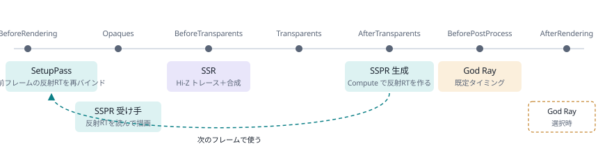

# God Ray・SSPR・SSR をコードから読む

このリポジトリに残っている 3 つのスクリーンスペース効果が、1 フレームの中でどの順に何を計算しているのかを、実際のシェーダーと C# のコードに沿って説明します。

| 機能 | ドキュメント | 概要 |
|---|---|---|
| God Ray（光芒） | [GodRay.md](GodRay.md) | 空の明るい部分を太陽の画面位置へ放射状にぼかし、光の筋を作る |
| SSPR（スクリーンスペース平面反射） | [SSPR.md](SSPR.md) | 画素を水平面で折り返して投影し、Compute で反射テクスチャを作る |
| SSR（スクリーンスペース反射） | [SSR.md](SSR.md) | Hi-Z（深度ピラミッド）上をレイマーチして任意の面の反射を作る |

各手順には、RenderDoc のキャプチャ（D3D12、1920×1080）から取り出した中間テクスチャを載せています。

> **画像の見方**
> - HDR のバッファ（R11G11B10 / RGBA16F）は ACES 近似でトーンマップし、sRGB で表示しています。
> - 深度は reversed-Z の値を対数で正規化し、手前ほど明るくしています。
> - 1 チャンネルのマスクは最大値で正規化しています。
> - Unity は D3D で中間 RT を上下反転して描くため、最終出力（GameView RT）以外は上下を戻して表示しています。
> - キャプションの「EID」は RenderDoc のイベント ID です。

## 1 フレームのどこで動くか

3 つの効果はすべて `SiriusPostProcessingFeature`（URP の ScriptableRendererFeature）から登録されます。各パスの実行タイミングは Volume の値で決まります。既定値での位置は次のとおりです。

| URP のタイミング | 実行されるパス | 内容 |
|---|---|---|
| BeforeRendering | SSPR `SetupPass` | 前フレームの反射 RT を再バインド |
| Opaques | SSPR 受け手 | 反射 RT を読んで描画 |
| BeforeTransparents | SSR | Hi-Z トレース＋合成 |
| AfterTransparents | SSPR 生成 | Compute で反射 RT を作る（次のフレームで使う） |
| BeforePostProcess | God Ray | 既定タイミング |
| AfterRendering | God Ray | Volume で選択したとき |

SSPR の反射テクスチャは、そのフレームの不透明描画が終わってから作られます。受け手のマテリアルが読むのは 1 フレーム前のテクスチャで、投影にも前フレームの VP 行列 `_CtPrevFrameVpMatrix` を使います。Render Graph はフレームの終わりにグローバルテクスチャをリセットするので、`SetupPass` が毎フレーム最初に前フレームの RT を再バインドしています。

## コードの位置

- `SiriusPackages/Sirius.PostProcessing`：各パスとシェーダー
- `SiriusPackages/Sirius.Core`：深度ミップ、Dual Blur、共通 HLSL
- デモシーン：`Assets/Demo/PostProcess_GodRay`・`PostProcess_SSPR`・`PostProcess_SSR`

各ドキュメントの参考資料で「直接の参考」「よく一致する」と書いたものは、コード内のコメントや変数名・定数の一致から判断したものです。
