# SSPR（スクリーンスペース平面反射）

水面や床のような「高さ `h` の水平面」に限定した反射です。普通の平面反射はカメラを鏡像の位置に置いてシーンをもう一度描きますが、SSPR は逆向きに考えます。画面上の各画素のワールド座標を平面で折り返し、それが画面のどこに映るかを計算して、その場所に元の画素の色を書き込みます（Pixel-Projected Reflection と呼ばれる方式）。シーンの再描画が要らないので、モバイルでも使える軽さになります。計算は Compute Shader で行います。

| 項目 | 内容 |
|---|---|
| パス | `SSPRPostProcessPass.cs` / `SSPRHelper.cs` / `SetupPass.cs` |
| シェーダー | `Resources/SSPRCompute.compute`, `Hidden/Sirius/UtilBlur` |
| 反射 RT | 正方形 `ReflectionTextureSize`（8 の倍数に切り上げ）, RGBA8 |
| Volume / 受け手 | `Sirius/SSPR` · キーワード `_CT_ENABLE_SSPR` |

コード：
- [SSPRPostProcessPass.cs](../SiriusPackages/Sirius.PostProcessing/Runtime/Scripts/Features/Passes/SSPR/SSPRPostProcessPass.cs)
- [SSPRCompute.compute](../SiriusPackages/Sirius.PostProcessing/Runtime/Shaders/Resources/SSPRCompute.compute)
- [SetupPass.cs](../SiriusPackages/Sirius.PostProcessing/Runtime/Scripts/Features/Passes/SetupPass.cs)

> **キャプチャ SSPR.rdc**：木の床の上に球・立方体・カプセル・板が並ぶシーンです。床を反射平面にしています。ReflectionTextureSize は 1024、Quality は High（FillHoles が実行されています）、ぼかしは 2 段です。

## 全体像：平面での折り返しと投影

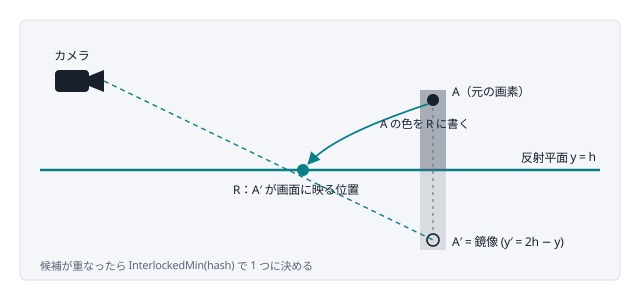

鏡像カメラから描き直すのではなく、すでに画面にある画素 A を平面で折り返して A′ を作り、A′ を投影した画素 R に A の色を「散布」します。候補が重なったら `InterlockedMin(hash)` で 1 つに決めます。

## アルゴリズムの流れ

### 1. カメラカラーを反射 RT と同じサイズに縮小コピーする

Compute の各スレッドが 1 テクセルを担当するので、入力の解像度を反射 RT（既定 512×512）に合わせておきます。

| 入力のシーンカラー | 縮小コピー |
|---|---|
| 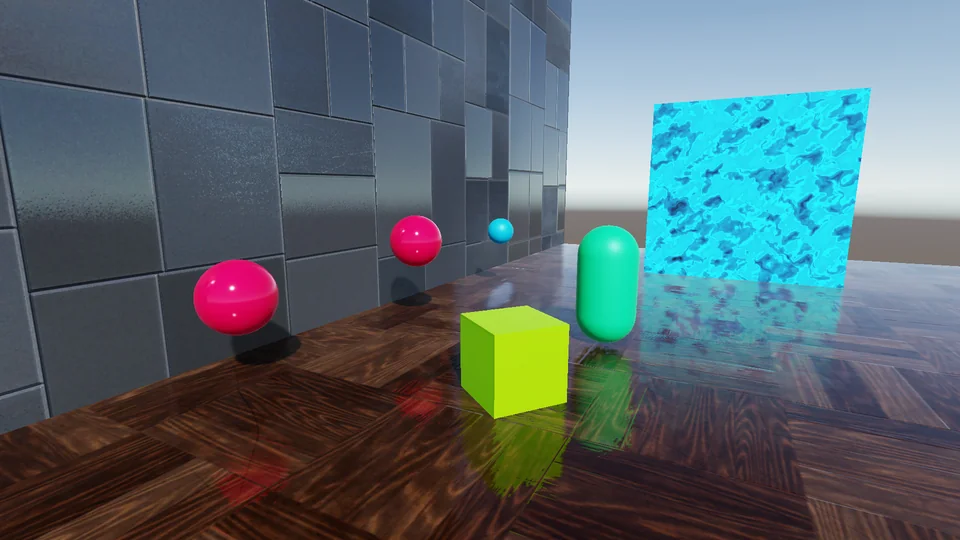 | 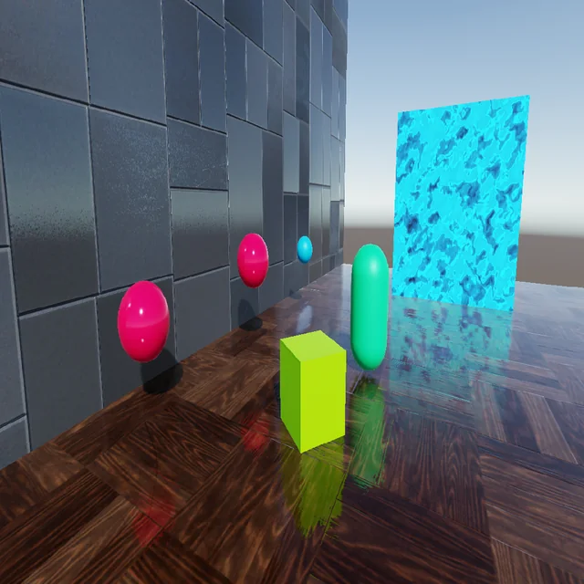 |
| 床の反射は前フレームの反射 RT を読んで描かれています。EID 1293 · `_CameraTargetAttachment` · 1920×1080 R11G11B10 | 1024×1024 に縮小コピーしたもの。正方形なので横方向が縮んでいます。EID 1321 · `_SSPR_CameraRT` · 1024×1024 R11G11B10 |

### 2. Clear カーネル：書き込み先を初期化する

反射色 `ColorRT` を (0,0,0,0) に、「どの候補が書き込んだか」を記録するバッファ `PosWSyRT` を `0xFFFFFFFF` にします。alpha = 0 は「SSPR の情報なし」を意味し、受け手はその部分で反射プローブにフォールバックします。

### 3. 深度からワールド座標を復元し、反射元にならない画素を捨てる

深度と自前で渡した逆 VP 行列 `_InvVPMatrix` からワールド座標を求めます（Metal で `UNITY_MATRIX_VP` が正しくなかったため、行列は C# から渡しています）。次の画素は反射元から外します。

- **反射平面（`h + bias`）より下にある画素**。平面の下は正しい反射になりえません。
- **カメラより下にある上向きの水平面（床そのもの）**。隣接画素のワールド座標の差分の外積で法線を求め、`n.y² > 0.9·|n|²` なら水平面と判定します。外さないと、平面の高さ設定が床より下にずれたときに床自身が反射を上書きしてしまいます。

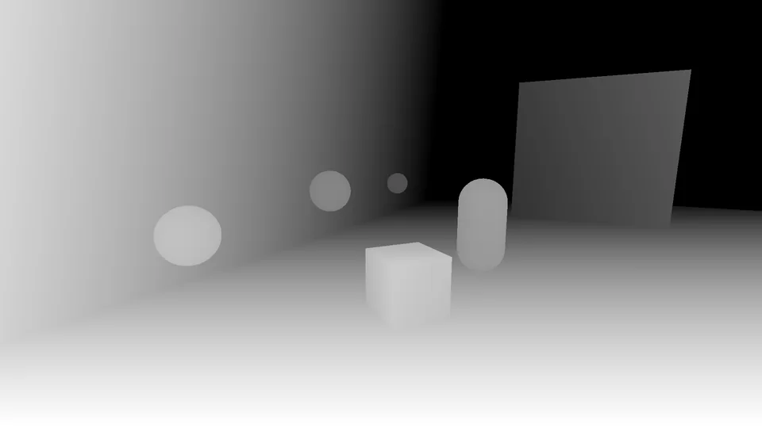

ワールド座標の復元に使う深度。Compute は反射 RT の解像度で動き、各スレッドが対応する UV で深度を読みます。
*EID 1337 で読み込み · `_CameraDepthTexture` · 1920×1080 R32F*

### 4. 平面で折り返し、反射先の画面座標を求める

`y' = 2h − y` で鏡像の点を作り、VP 行列で投影して UV にします。鏡像は画面の左右端で欠けやすいので、Ghost Recon Wildlands の手法にならって、画面端に近いほど UV を横方向に引き伸ばす補正（`ScreenLRStretch*`）を入れています。画面外に出たら終了します。

### 5. 同じ反射先に来た候補の中から 1 つを選ぶ

複数の画素が同じ反射先に投影されることがあり、Compute の書き込み順は不定です。そこで、元画素の座標を `hash = id.y << 16 | id.x` に詰め、`InterlockedMin` で最小値だけを残します。深度バッファの Z テストと同じ役割で、毎フレーム同じ候補が選ばれるのでちらつきません。選ばれたスレッドだけが元画素の色を書き込みます。

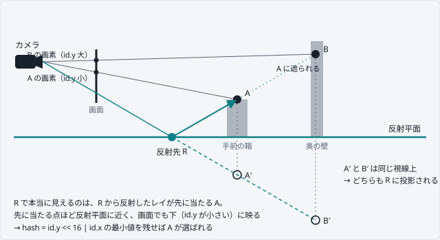

横から見た図です。A と B は画面上の別々の画素ですが、平面で折り返した A′ と B′ がカメラから見て同じ視線上に並ぶので、反射先は同じ R になります。鏡を正しく描くなら R に映るのは手前の A で、B は A に隠れます。同じ視線上の候補では、反射平面に近い点ほど画面でも下に映ります（Unity の RT では id.y = 0 が画面下）。そのため **id.y を上位ビットに置いた hash の最小値が、Z テストで最も手前の候補を残すのと同じ結果になります**。id.x は同じ行の候補の順位を一意にするためのもので、なくても見た目はほぼ変わりません。

Android の一部端末（Pixel 6 / 8a で確認）では `InterlockedMin` が正しく動かなかったため、通常の `min` を 5 回繰り返す近似に切り替えています。

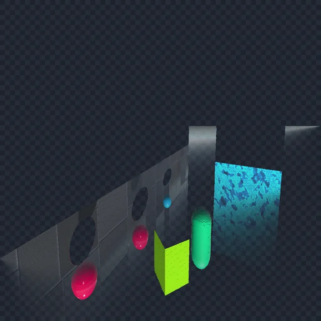

Resolve 直後の ColorRT（市松模様は alpha = 0 の部分）。床より上の物体が上下反転して、床の位置に書き込まれています。
*EID 1337 · `_SSPR_ColorRT` · 1024×1024 RGBA8*

### 6. 端のフェードと色味

元画素が画面の上端・左右端に近いほど alpha を下げます（左右のフェード幅は平面からの高さに比例）。そのあと `TintColor` を掛けます。

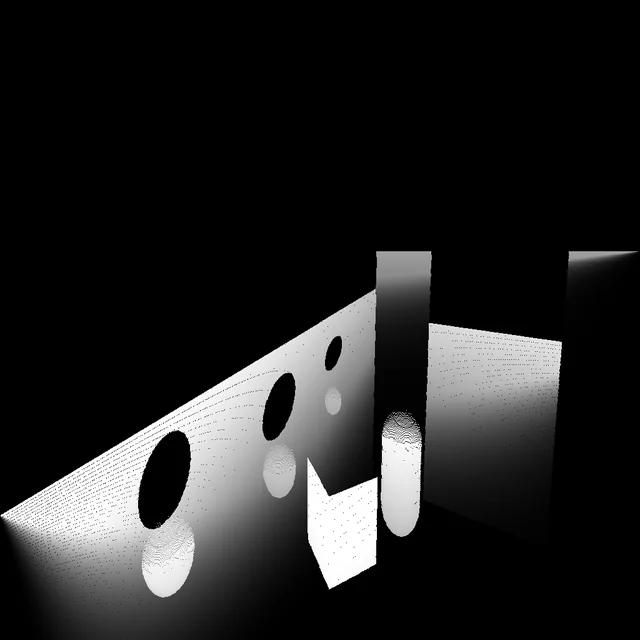

同じ ColorRT の alpha。奥（画面上端に近い元画素）ほど暗くなっていて、上端のフェードが分かります。物体の形の黒い穴は、手前の物体に隠されて反射元の画素がない部分です。
*EID 1337 · `_SSPR_ColorRT.a`*

### 7. FillHoles カーネル：穴埋め（Quality = High のとき）

投影は 1 対 1 ではないので、何も書き込まれない画素（穴）が残ります。2×2 ブロックごとに alpha が最大の画素を探し、それより alpha が 0.5 以上低い画素をその色で埋めます。

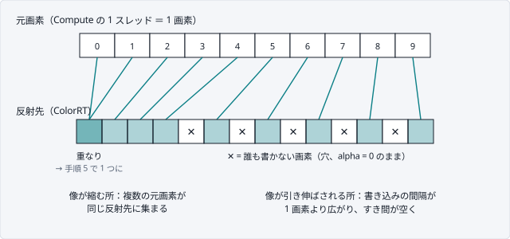

SSPR は「元画素ごとに書き先を 1 つ計算して書き込む」散布（scatter）型の処理です。普通の描画は出力画素ごとに色を求める（gather）ので必ず全画素が埋まりますが、散布では書き込まれない画素が出ることがあります。元画素と反射先の対応は透視投影と折り返しを通るので間隔が均一ではありません。鏡像はカメラからの距離が元の点と異なるため、画面上で元の像より大きくも小さくも映ります。さらに画面端の左右引き伸ばし補正（`ScreenLRStretch`）でも書き込みの間隔が広がります。間隔が 1 画素を超えた所が穴になります。FillHoles は、2×2 ブロックのうち alpha が十分高い画素の色をこの穴にコピーします。

| FillHoles 前（96×96 テクセルを拡大） | FillHoles 後 |
|---|---|
| 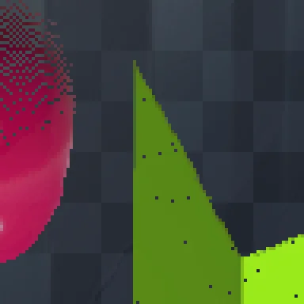 | 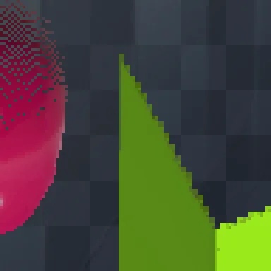 |
| 立方体の反射の中に、どの元画素からも書き込まれなかった黒い点が散っています。EID 1337 · `_SSPR_ColorRT`（一部） | 同じ範囲の点が 2×2 ブロック内の色で埋まりました。EID 1342 · `_SSPR_ColorRT`（一部） |

### 8. Dual Blur でぼかし、グローバルテクスチャとして公開する

4 タップのボックスフィルタで最大 `BlurTextureMipCount` 段まで縮小し、拡大しながら `lerp(高解像度, 低解像度, BlurIntensity)` で合成します。結果をフレームをまたいで保持する RT に書き、`_CtScreenSpacePlanarReflectionTex` として公開します。

| 縮小 1 段目（512×512） | 最終的な反射 RT |
|---|---|
|  |  |
| EID 1354 · `SSPRMipDown_1` · 512×512 RGBA8 | 縮小した段と元の解像度を BlurIntensity で混ぜ、輪郭が少しぼけています。EID 1365 · `_SSPR_ReflectionRT` · 1024×1024 RGBA8 |

### 9. 受け手のマテリアルで読む（次のフレーム）

受け手はワールド座標を前フレームの VP 行列で投影した UV で反射テクスチャを読みます。ディストーションマップで UV をずらせば水面の揺らぎになります。Lit 版のデモでは、法線で曲げた反射方向の先を読み、alpha で反射プローブとブレンドし、URP と同じ環境 BRDF と AO を掛けています。

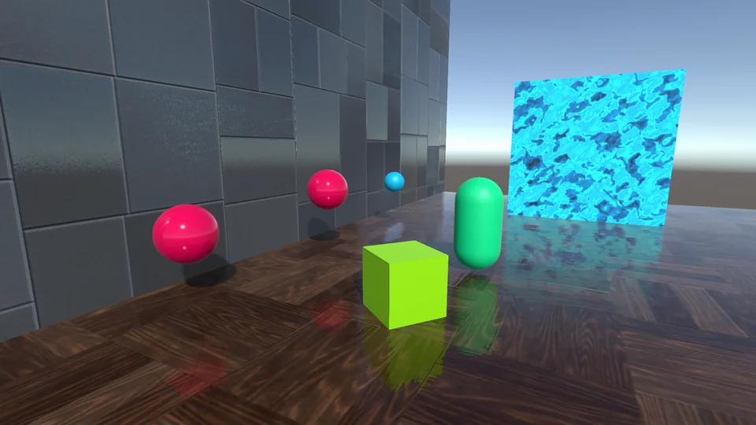

最終出力（上下反転していない向き）。床に球・立方体・カプセル・板が映っています。この反射は 1 フレーム前に作った反射 RT を読んだものです。
*EID 1436 · GameView RT · 1920×1080 RGBA8 sRGB*

## 中心部のコード

```hlsl
// SSPRCompute.compute — MobilePathSinglePassColorRTDirectResolve
float3 posWS = ConvertScreenUVToPosWS(screenUV);
if (posWS.y <= planeHeightWS) return;                     // 平面の下は反射元にしない
if (IsUpwardHorizontalSurface(screenUV, posWS)) return;   // 床自身を外す
float3 reflectedPosWS = MirrorPosWS(posWS, planeHeightWS);
float2 reflectedScreenUV = ConvertReflectedPosWSToScreenUV(reflectedPosWS, planeHeightWS);
uint2 reflectedScreenID = reflectedScreenUV * _RTSize;
uint projectionHash = id.y << 16 | id.x;
InterlockedMin(PosWSyRT[reflectIndex], projectionHash);
if (PosWSyRT[reflectIndex] == projectionHash)              // 自分が勝ったときだけ色を書く
    ColorRT[reflectedScreenID] = half4(sceneColor, fadeoutAlpha) * _FinalTintColor;
```

## 参考資料

- **カーネル構成（MobilePathSinglePassColorRTDirectResolve / FillHoles）と InterlockedMin による候補選択の直接の参考**
  [Colin Leung, UnityURP-MobileScreenSpacePlanarReflection (GitHub)](https://github.com/ColinLeung-NiloCat/UnityURP-MobileScreenSpacePlanarReflection)
- **画素を平面で折り返して投影する方式と、左右端の引き伸ばし補正**（コード内コメントで参照）
  [Rémi Genin, "Screen Space Plane Indexed Reflection in Ghost Recon Wildlands"](http://remi-genin.fr/blog/screen-space-plane-indexed-reflection-in-ghost-recon-wildlands/)
- **Pixel-Projected Reflection の原典**（Colin Leung の README で参照）
  [Adam Cichocki, "Optimized Pixel-Projected Reflections for Planar Reflectors", SIGGRAPH 2017 Advances in Real-Time Rendering](https://advances.realtimerendering.com/s2017/PixelProjectedReflectionsAC_v_1.92_withNotes.pdf)
- **鏡像位置から UV を求める処理とプラットフォーム別の UV 反転**（コード内コメントで参照）
  [Steven Cannavan, URP_ScreenSpacePlanarReflections (GitHub)](https://github.com/Steven-Cannavan/URP_ScreenSpacePlanarReflections)
- **深度からのワールド座標復元**（コード内コメントで参照）
  [かもそば, 【ShaderGraph】デプスからワールド座標を復元するカスタムノード (Zenn)](https://zenn.dev/r_ngtm/articles/shadergraph-reconstruct-wpos-depth)
- **Android で InterlockedMin が効かない問題と回避策**（コード内コメントで参照）
  - [Unity Discussions, Equivalent to InterlockMin in OpenGL/Vulkan](https://discussions.unity.com/t/equivalent-to-interlockmin-in-opengl-vulkan/927172)
  - [Game Development Stack Exchange, Unity compute shader InterlockedMin/Max not work on Android](https://gamedev.stackexchange.com/questions/206967/unity-compute-shader-interlockedmin-max-not-work-on-android)
- **反射 RT のぼかしに使う Dual Filter（Dual Blur）の原典**
  [Marius Bjørge (Arm), "Bandwidth-Efficient Rendering", SIGGRAPH 2015 Moving Mobile Graphics（スライド PDF）](https://community.arm.com/cfs-file/__key/communityserver-blogs-components-weblogfiles/00-00-00-20-66/siggraph2015_2D00_mmg_2D00_marius_2D00_slides.pdf)
- **移植元としてコード先頭に記載されたリポジトリ**（公開状況は未確認）
  github.com/sge-div/gfx-sspr
