# SSR（スクリーンスペース反射）

任意の向きの面に対する反射です。画素ごとに反射ベクトルを作り、深度バッファの上をレイマーチして、最初にぶつかった画素の色を反射色として使います。単純に等間隔で進むと何十〜何百ステップかかるので、深度の「最小値ミップマップ」（Hi-Z）を使って、何もない区間は大きく、物体の近くでは細かく進みます。トレースと合成は 2 つのフルスクリーンパスに分かれています。

| 項目 | 内容 |
|---|---|
| パス | `SSRPass.cs` / `SSRHelper.cs` |
| シェーダー | `Hidden/Sirius/SSR`, `Hidden/Sirius/DepthMipMapUtil` |
| 入力 | 深度・法線・GBuffer（Diffuse / Smoothness / Metallic / AO） |
| Volume | `Sirius/Screen Space Reflections` |

コード：
- [SSRPass.cs](../SiriusPackages/Sirius.PostProcessing/Runtime/Scripts/Features/Passes/SSR/SSRPass.cs)
- [SSR.shader](../SiriusPackages/Sirius.PostProcessing/Runtime/Shaders/SSR/SSR.shader) / [SSRCommon.hlsl](../SiriusPackages/Sirius.PostProcessing/Runtime/Shaders/SSR/SSRCommon.hlsl)
- [DepthMipMapUtil](../SiriusPackages/Sirius.Core/Runtime/Scripts/DepthMipMapUtil/)

> **キャプチャ SSR.rdc**：SSPR と同じシーンを Deferred レンダリングで描いています。Volume で SSPR は使わず、床の反射は SSR だけで作られています。`downSample` が有効なので、トレースは 960×540 の深度ピラミッド（10 段）だけを読み、結果も 960×540 です。

## アルゴリズムの流れ

### 1. Hi-Z（深度ピラミッド）を作る

カメラ深度を半解像度に縮小し、そこから最大 11 段のミップを作ります。各テクセルは下の段の 2×2 の「最もカメラに近い深度」です（reversed-Z では `max`）。元の幅・高さが奇数のときは 1 テクセルが 3 テクセル分にまたがるので、追加でサンプルして漏れを防ぎます。`downSample` が無効なら、全解像度の深度を仮想的な lod 0 として段の先頭に加えます。

| 元のカメラ深度（全解像度） | ミップ 0：半解像度の深度 |
|---|---|
| 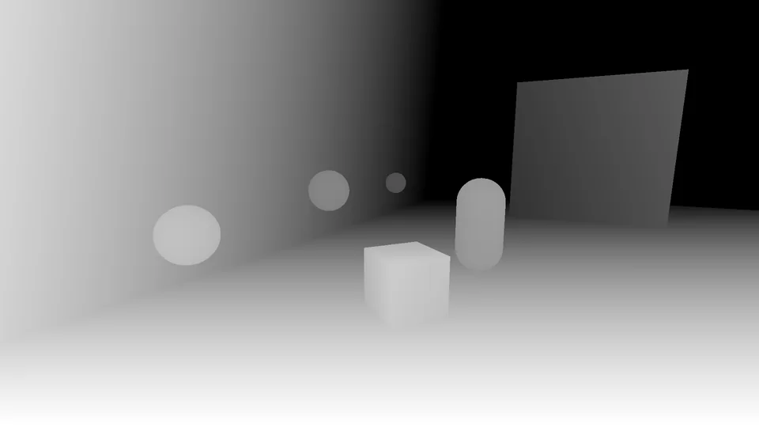 |  |
| `_CameraDepthTexture` · 1920×1080 R32F | EID 1646 で読み込み · `_HalfStartDepthMipMap` mip 0 · 960×540 R16F |

| ミップ 2 | ミップ 4 | ミップ 6 |
|---|---|---|
|  | 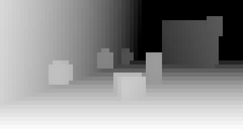 | 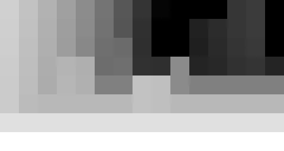 |
| 240×135 | 60×33（奇数サイズ）。物体の輪郭が手前（明るい側）に太っていくのが「最も近い深度」を残す縮小の特徴です | 15×8。1 テクセルが画面の 1/15 幅を覆います。何もない区間ではレイがこの粗さで一気に進みます |

### 2. カメラカラーをミップ付きでコピーする

合成時に、ラフな面ほど低解像度のミップを読んでぼけた反射にするためです。

| ミップ 0（1920×1080） | ミップ 3（240×135 を拡大表示） |
|---|---|
| 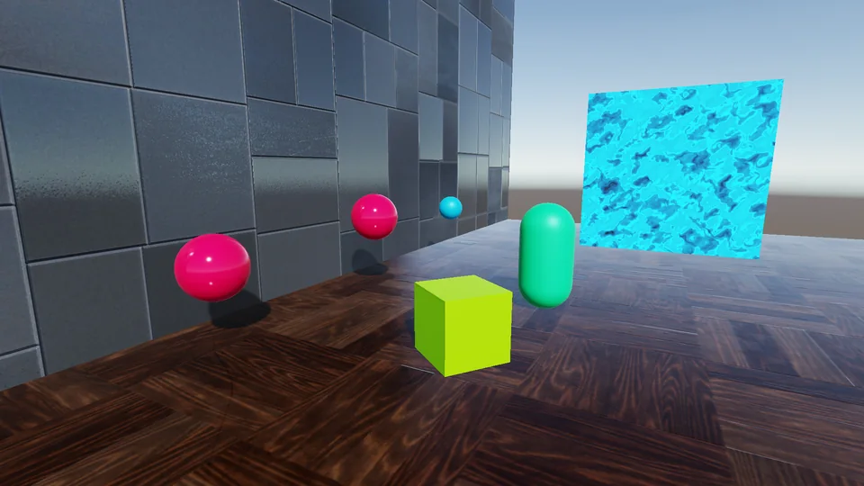 |  |
| EID 1646 時点 · `SSR_CameraColorCopyTexture` mip 0 · R11G11B10、全 11 段 | ラフな面の反射はこの程度にぼけた色を読みます |

### 3. 反射レイをテクスチャ空間に置く

空の画素や Smoothness が `minSmoothness` 以下の画素はトレースしません。それ以外は、深度から位置を復元し、視線を法線で反射させ、ビュー空間で少し先の点を射影します。始点と終点の差を「スクリーン UV（xy）＋ 深度（z、手前 0・奥 1）」の空間での方向にします。カメラへ戻ってくるレイ（`v.z ≤ 0`）は扱わず、カメラ正面方向との内積が小さいレイはマスクで弱めます。

| GBuffer2.rgb の法線 | GBuffer2.a の Smoothness |
|---|---|
| 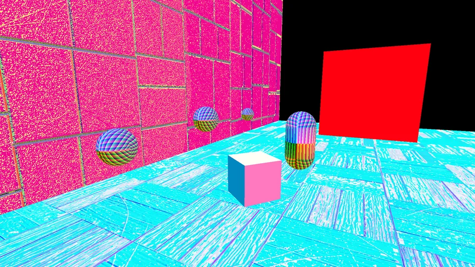 | 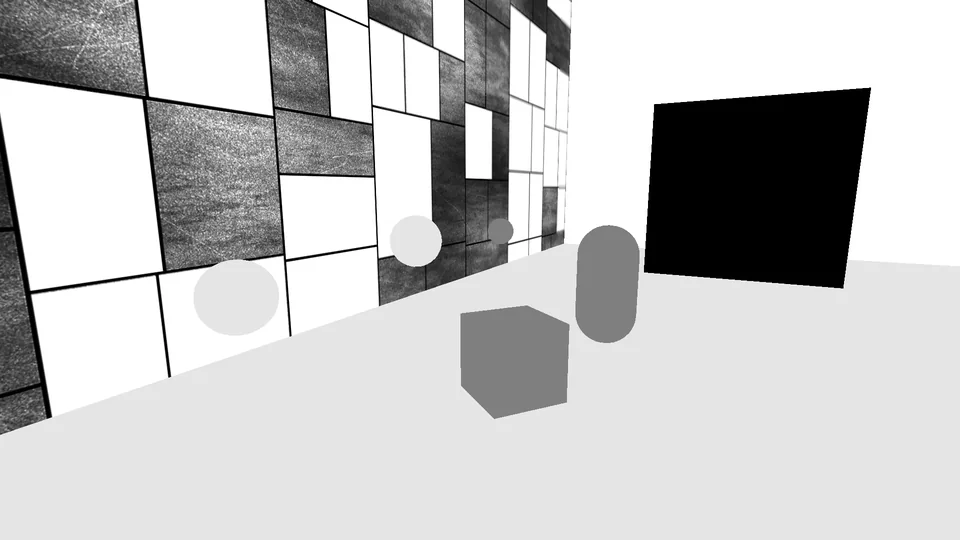 |
| エンコードされた値をそのまま表示。反射ベクトルの計算に使います。`_GBuffer2` · 1920×1080 RGBA8 | 床と壁の一部のタイルが高く、奥の板（黒）は 0 なのでトレースされません |

### 4. Hi-Z トレース

方向を z = 1 に正規化し（`d = v / v.z`）、まず隣のセル境界まで進めて自己交差を避けます。そのあとループで次を繰り返します。

- 現在のレベルのセルの最小深度 `minZ` を読み、レイがそれより手前なら `minZ` の深さまで進める。
- 進めた結果セルの外に出るなら、代わりにセル境界で止めて**レベルを上げる**（次は大きく進む）。
- セル内に収まれば**レベルを下げて**細かく調べ直す。
- 最下段で、レイが `minZ + thickness` より奥にあるなら物体の裏側を通過したとみなし、セル境界を越えて続ける。

レベルが開始レベルより下がったら交差です。`reflectSky` が無効なら空に当たった時点で打ち切ります。結果テクスチャ（RGBA16F）には、交差点の UV と、画面端で弱めたマスクを書きます。

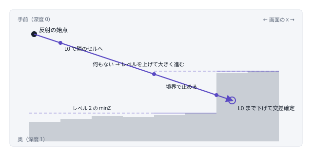

深度断面の模式図。灰色の柱が各画素の深度、紫の線が上位レベルの「セル内の最小深度」です。レイは上位レベルのセルを 1 回で通り抜け、物体の近くではレベルを下げて細かく進みます。

| 交差点の UV（RG） | ヒットマスク（B） |
|---|---|
| 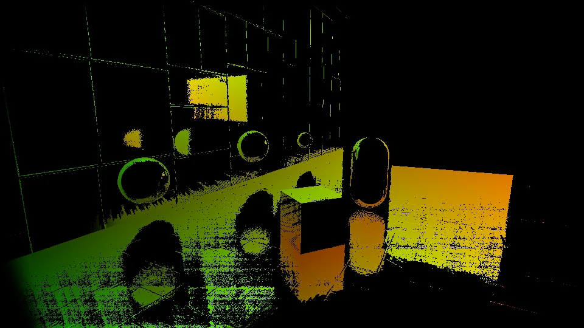 | 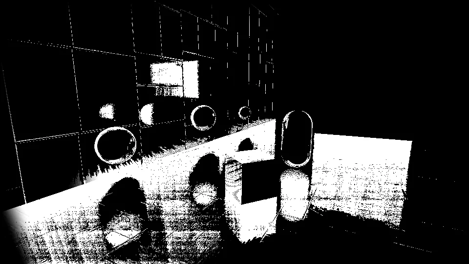 |
| R が横、G が縦。マスクを掛けて表示。床の上で、反射して見える物体の位置ごとに色が変わります。EID 1646 · `SSR_ReflectionTexture.rg` · 960×540 RGBA16F | 白いところでレイが何かに当たっています。床の物体の真下の黒い部分は、レイが物体の裏側に入り、交差が見つからなかった所です。`SSR_ReflectionTexture.b` |

### 5. 合成

交差 UV でコピーしたカラーを読み、次の重みでシーンに混ぜます。

- **ディザ**：8×8 Bayer 行列か Interleaved Gradient Noise で、ラフな面ほど法線方向に UV をずらし、低いサンプル数の縞をノイズに変える。
- **ぼかし**：Smoothness が低いほど高いミップ（最大 lod 5）を読む。
- **フレネル**：`1 − dot(V, N)` を、非金属では 2 乗して斜めから見たときだけ強くする。
- **金属**：Metallic が高いほど反射を Diffuse 色で染め、元の色を弱める。
- **その他**：AO で弱め、輝度が 1 を超える発光面は反射させない。

```
result = lerp(source, source·(1−fm) + reflected·specColor·fm, mask · AO · fresnel · luminMask)
```

| GBuffer0 の Diffuse | GBuffer1.r の Metallic |
|---|---|
| 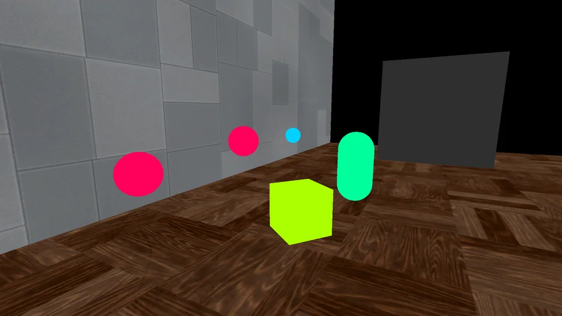 | 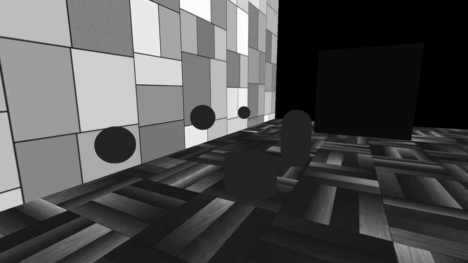 |
| 金属面の反射色（specColor）に使います。`_GBuffer0` · RGBA8 sRGB | `_GBuffer1.r` |

| 合成前 | 合成後 |
|---|---|
|  | 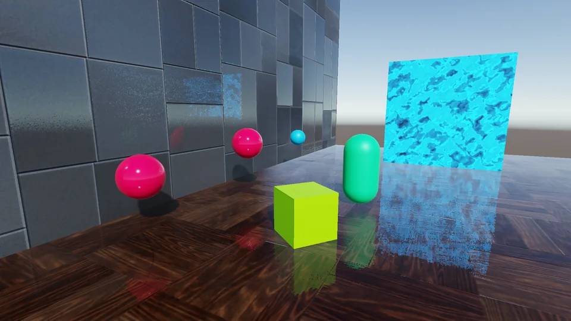 |
| EID 1646 時点 · `_CameraTargetAttachment` | 床に球・立方体・カプセル・板の反射が加わり、壁のタイルにも空と板が映っています。EID 1675 · `_CameraTargetAttachment` · 1920×1080 R11G11B10 |

| 合成前後の差（4 倍に強調） | 最終出力 |
|---|---|
| 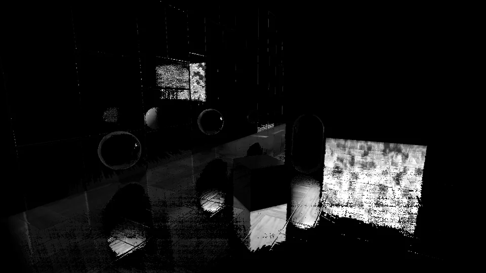 | 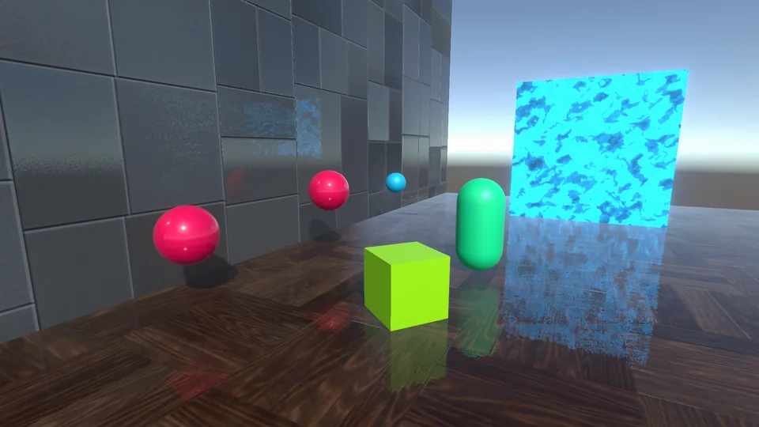 |
| 反射が加わった場所だけが明るくなります。板の反射に見える細かいムラは主に合成時のディザによるものです | 上下反転していない向き。EID 1912 · GameView RT · 1920×1080 RGBA8 sRGB |

## 中心部のコード

```hlsl
// SSR.shader — HiZTrace（ループ部分）
float minZ = GetMinDepthPlane(oldCellIdx, level);
float3 tmpRay = (minZ - ray.z) > 0 ? IntersectDepthPlane(ray, d, minZ - ray.z) : ray;
if (CheckCrossedCellBoundary(oldCellIdx, GetCellIndex(tmpRay.xy, cellCount)))
{
    tmpRay = IntersectCellBoundary(ray, d, oldCellIdx, cellCount, crossStep, crossOffset);
    level = min(rootLevel, level + 2);          // 直後の --level と合わせて 1 段上がる
}
else if (level == startLevel && tmpRay.z > minZ + (1 - p.z) * thickness)
{
    tmpRay = IntersectCellBoundary(ray, d, oldCellIdx, cellCount, crossStep, crossOffset);
    level = startLevel + 1;                     // 物体の裏を通過 → 同じレベルで続行
}
--level;
ray = tmpRay;
```

## 参考資料

- **Hi-Z トレースの原典**（最小深度ミップを使ったセル単位のレイ進行）
  [Yasin Uludag, "Hi-Z Screen-Space Cone-Traced Reflections", GPU Pro 5 (CRC Press, 2014)](https://gameenginegems.com/gemsdb/article.php?id=1221)
- **Hi-Z トレースの実装解説**（crossStep / crossOffset、レベルの上げ下げ）
  [Sugu Lee, "Screen Space Reflections: Implementation and optimization – Part 2: HI-Z Tracing Method"](https://sugulee.wordpress.com/2021/01/19/screen-space-reflections-implementation-and-optimization-part-2-hi-z-tracing-method/)
- **合成パス（8×8 ディザ、輝度マスク、金属・フレネルのブレンド定数）がよく一致する URP 向け実装**
  [Joshua Lim, Unity-ScreenSpaceReflections-URP (GitHub)](https://github.com/JoshuaLim007/Unity-ScreenSpaceReflections-URP)
- **Hi-Z トレースの注意点のまとめ**
  [Bitsquid development blog, "Notes On Screen Space HIZ Tracing"](http://bitsquid.blogspot.com/2017/08/notes-on-screen-space-hiz-tracing.html)
- **奇数サイズのミップを作るときの追加サンプル**（DepthMipMapUtil の処理と同じ考え方）
  [Mike Turitzin, "Hierarchical Depth Buffers"](https://miketuritzin.com/post/hierarchical-depth-buffers/)
- **スクリーンスペースのレイトレース全般**（線形マーチとの比較）
  [Morgan McGuire, Michael Mara, "Efficient GPU Screen-Space Ray Tracing", JCGT Vol. 3 No. 4 (2014)](https://jcgt.org/published/0003/04/04/)
- **合成時のディザ（IGN）**
  [Jorge Jimenez, "Next Generation Post Processing in Call of Duty: Advanced Warfare"](https://www.iryoku.com/next-generation-post-processing-in-call-of-duty-advanced-warfare/)
